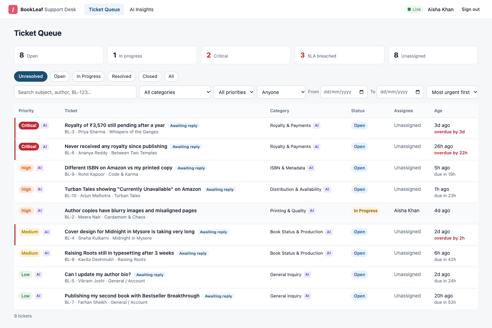
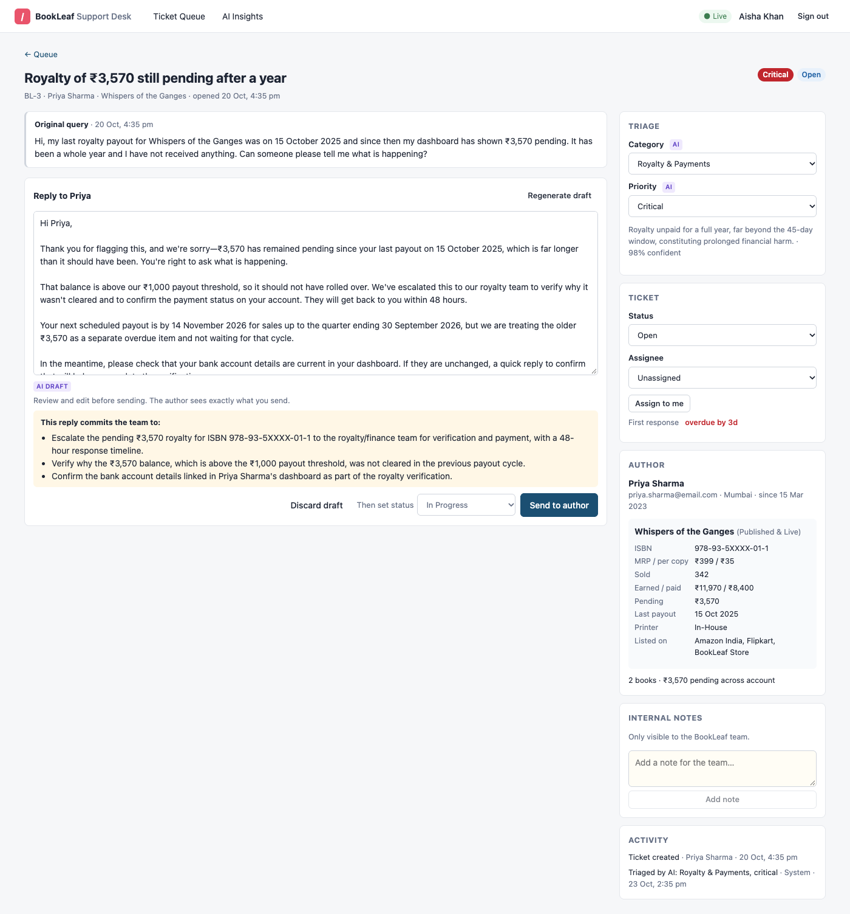
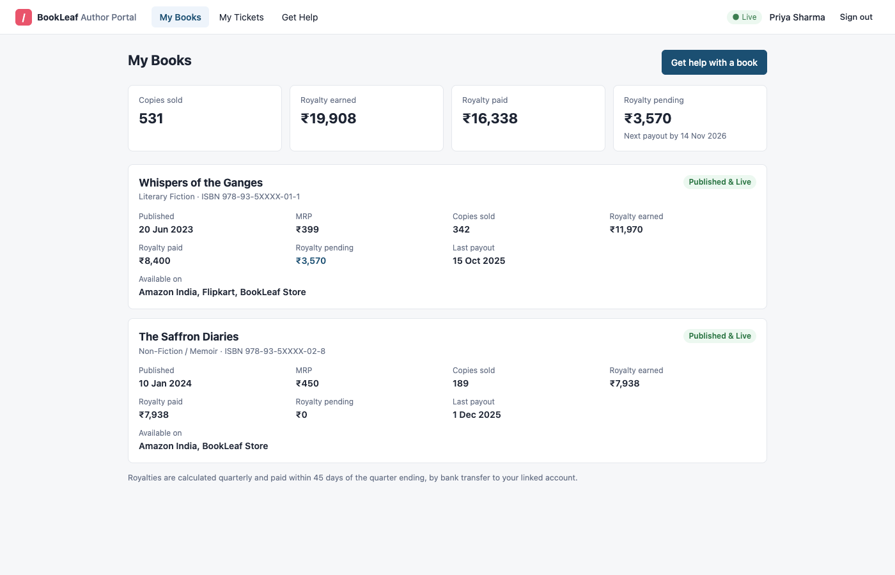
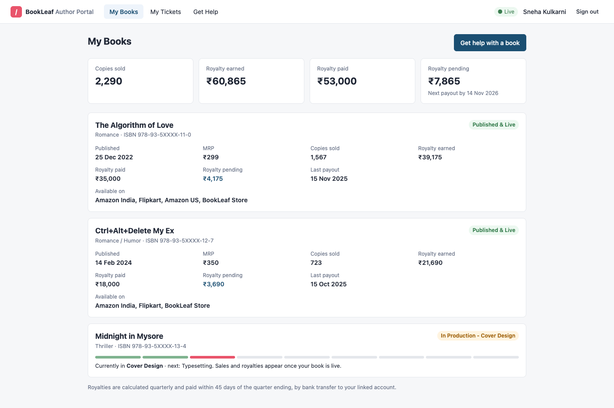

# BookLeaf Author Support & Communication Portal

A support desk for BookLeaf Publishing with two faces:

- **Author portal**: authors see their books and royalties, raise tickets (with attachments), and follow replies live.
- **Admin desk**: the ops team works an urgency-ordered queue. An LLM (DeepSeek by default) classifies and prioritises every new ticket and drafts replies grounded in BookLeaf's knowledge base and the author's actual account data.

**Live demo:** _URL to be added after deployment_ · **Write-up:** [WRITEUP.md](WRITEUP.md)

| Admin queue | AI-drafted reply |
|---|---|
|  |  |
| **Author: books & royalties** | **Author: book in production** |
|  |  |

<sub>Screenshots show real DeepSeek Flash output on the seeded data: triage labels, confidence, and the draft with its action checklist.</sub>

## Test credentials

The login page has one-click buttons for these.

| Role | Email | Password |
|---|---|---|
| Admin | `admin@bookleafpub.com` | `Admin@123` |
| Admin | `support@bookleafpub.com` | `Admin@123` |
| Any author in the sample data | e.g. `priya.sharma@email.com` | `Author@123` |

Authors worth trying for edge cases:

- `sneha.kulkarni@email.com`: a book in production (Cover Design).
- `kavita.deshmukh@email.com`: a book in production plus a ₹850 balance that's below the ₹1,000 payout threshold.
- `ananya.reddy@email.com`: earned royalties but never paid.

The database is seeded from BookLeaf's `bookleaf_sample_data.json` (10 authors, 18 books) plus 10 realistic demo tickets, so the queue isn't empty on first login.

## Running locally

Requires Node 22+. No database or API key is needed to start.

```bash
npm install
cp .env.example .env      # optional: add DEEPSEEK_API_KEY to enable AI
npm run dev               # API on :4000, web on http://localhost:5173
```

- **Database:** with no `DATABASE_URL`, the server runs an embedded Postgres (PGlite) in `server/.data/`. Set `DATABASE_URL` to use a real Postgres. Migrations run automatically on boot, and demo data is seeded if the database is empty.
- **AI:** with no `DEEPSEEK_API_KEY` (or `ANTHROPIC_API_KEY`), the app runs in manual mode. Tickets are triaged by keyword rules and admins write replies themselves. Everything else works.
- **Reset data:** `npm run db:seed -- --reset`
- **Tests:** `npm test` (44 tests: API, role-based access, AI pipeline, fallbacks, royalty date logic)
- **Production build:** `npm run build && npm start` serves the API and the built SPA from one process on `:4000`.

## Architecture

```
React SPA (Vite, TanStack Query)
   │  REST + httpOnly session cookie          ▲ Server-Sent Events ("ticket X changed")
   ▼                                          │
Express API ── auth/RBAC middleware ── routes ─► services ──► Drizzle ──► Postgres
                                                    │
                                                    ├─ TriageService ─┐
                                                    └─ DraftService ──┴─► AiGateway ─► LlmClient (DeepSeek | Claude)
                                                                          (circuit breaker, usage ledger)
```

```
server/src
  ai/            LLM interface + DeepSeek/Claude clients, gateway, triage, drafting, prompts, knowledge base, account facts, rule fallback
  modules/       auth, books, tickets (schemas → routes → service → presenter), admin stats, realtime hub
  db/            schema, migrations runner, seed
  middleware/ lib/ config/
web/src
  pages/author, pages/admin, components, lib (api client, auth, realtime hook)
```

**Key decisions**

| Decision | Why |
|---|---|
| TypeScript end to end, Express + React | My strongest stack. One language across client, server and validation schemas. |
| One deployable (API serves the SPA) | One URL to test and no CORS. The session cookie works for both REST and SSE. |
| Postgres via Drizzle; PGlite when no `DATABASE_URL` | A relational model fits tickets/messages/books. PGlite gives reviewers zero-setup local runs on the *same* SQL and migrations as production. |
| Dependency injection (`buildServices(db, llm, config)`) | Tests run the whole app against in-memory Postgres and a fake LLM. Swapping AI providers means touching one file. |
| Internal notes in their own table | They can't leak to authors through a forgotten `WHERE` clause. Author responses also go through a separate serializer that strips triage fields, assignee and staff names. |
| Other authors' tickets return 404, not 403 | Ticket IDs can't be probed. |
| Thin realtime events | SSE pushes only "ticket X changed" and clients refetch through the normal access-controlled API, so authorization lives in one place. |
| Audit log (`ticket_events`) | Every status change, override, assignment and AI triage is recorded. Override counts double as an AI accuracy signal. |

**Data model** (`server/src/db/schema.ts`): `users` (both roles) → `authors` (keeps BookLeaf's `AUTH001` IDs) → `books`; `tickets` (status, category/priority plus *source* `AI | RULES | ADMIN`, triage state, assignee, SLA timestamps) → `ticket_messages` (public thread, with `ai_draft_id` and `ai_draft_edited`), `internal_notes`, `attachments` (bytea), `ai_drafts` (cached), `ticket_events` (audit), `ai_calls` (token and latency ledger).

## AI integration

### Pipeline

1. **Ticket created.** It is saved and the author gets a response immediately. Triage then runs asynchronously, so the AI never blocks or fails ticket creation.
2. **Triage** (`ai/triage-service.ts`). One small LLM call with thinking turned off returns `{category, priority, confidence, rationale}` as JSON, validated against a Zod schema. If an admin has already overridden a field, that value is never overwritten. On boot, any ticket left untriaged (by a crash or a fresh seed) is picked up again.
3. **Admin opens the ticket.** A draft is generated, or a cached one is reused. The admin edits and sends it, or discards it and writes their own.
4. **Draft output** (`ai/draft-service.ts`) is structured:
   - `reply`: the message itself.
   - `agent_actions`: the commitments the reply makes ("Trigger Amazon re-sync…"). These are shown to the admin as a checklist, so a draft can't promise something the team never does.
   - `suggested_status`: pre-selects the status the ticket moves to after sending.

### Prompt strategy (`ai/prompts/`, `ai/knowledge-base.ts`)

- **The knowledge base is split by topic.** Each draft gets the core (company overview and tone guidelines), plus the one policy section and calibration examples for the ticket's category. BookLeaf's sample query→response table is used as few-shot guidance in each section.
- **Facts are computed, not inferred** (`ai/account-facts.ts`). Code works out the next payout date (quarter end + 45 days), whether the ₹1,000 threshold is met, whether a payout looks overdue, and the current production stage and what comes next. The model receives these as plain statements. LLMs are unreliable at date arithmetic; this is what lets a draft say "next payout by 14 November 2026" correctly.
- **Tone rules** come straight from BookLeaf's guidelines: acknowledge first, use real numbers, own mistakes, give a concrete timeline, end with a next step, and a fixed sign-off. The prompt also forbids inventing order numbers, dates or policies.
- **Prompt-injection hygiene.** Author text is wrapped in `<ticket>`/`<conversation>` tags and the system prompt says to treat it as data. Internal notes are never sent to the model, so nothing internal can end up in an author-facing draft.
- **Classification** uses a small rubric-based prompt (category definitions plus priority levels with examples) and no knowledge base at all.

### Graceful degradation

| Failure | Behaviour |
|---|---|
| No API key | Manual mode: rule-based triage (marked **RULES** in the UI), no drafts, and a banner explains why. |
| Timeout, 429 or 5xx | The SDK retries with backoff (`AI_MAX_RETRIES`, 20 s timeout). If it still fails, triage falls back to rules, and the draft endpoint returns `503 AI_UNAVAILABLE`, which the composer shows next to a Retry button while the admin keeps typing. |
| Repeated failures | A circuit breaker in `AiGateway` pauses AI calls for 60 s after 3 consecutive transient errors, so requests fail fast instead of stacking up timeouts. The UI shows "AI degraded". |
| Refusal, truncated or invalid output | DeepSeek's JSON mode isn't schema-enforced (and occasionally returns empty content), so every response is validated against the Zod schema and retried once. If it's still unusable: typed `LlmError` (`REFUSED`/`INVALID_OUTPUT`), same fallback path. |
| Out of credit | DeepSeek's 402 maps to `QUOTA`: triage falls back to rules, drafts show the manual-reply message. |
| Rules-triaged tickets | An admin can click **Re-run AI triage** once the AI is back. |

### Cost management

- **Lazy drafts.** Drafts are generated only when an admin opens a ticket, never for every incoming ticket.
- **Cached drafts.** A draft is stored and reused until the conversation changes (tracked by message count), so reopening a ticket or another admin viewing it costs nothing. Concurrent requests for the same ticket share one call.
- **Scoped context.** A draft system prompt is about 800–950 tokens, against about 1,850 if the whole knowledge base went in. Only the relevant book's facts are included, the thread is trimmed to the last 6 messages with each message capped, and long tickets are truncated. Classification is about 600 input tokens.
- **Prompt caching.** The system prompt is ordered stable→specific (core, then category section), so tickets in the same category share a prefix. DeepSeek caches repeated prefixes automatically and bills cache hits at about 2% of the normal input price. In testing, the second classification already read 512 of its ~730 input tokens from cache. (With Claude, the same ordering plus a `cache_control` breakpoint does the job.)
- **Right-sized reasoning.** Classification runs with thinking **off** (`AI_CLASSIFY_EFFORT=none`): it's a rubric lookup, and turning thinking off cuts it to ~1 s and ~50 output tokens. Drafting uses `low` reasoning effort (`AI_DRAFT_EFFORT`). Both are tunable without code changes.
- **Measured, not guessed.** Every call is written to `ai_calls` (tokens, cache reads, latency, outcome). The **AI Insights** page shows spend, failure rate and quality signals: the triage override rate, the share of replies sent from drafts, and the share of drafts sent unedited. Measured on DeepSeek Flash at peak-hour prices: triage ≈ $0.0001–0.0003 and a draft ≈ $0.0008–0.0018, so about **$1–2 per 1,000 tickets** (half that off-peak). The Insights page has the live figure.

### Model choice

**DeepSeek Flash (`deepseek-flash`, V4.1-Flash) for both triage and drafts**, set by `AI_CLASSIFY_MODEL` / `AI_DRAFT_MODEL`. I compared it with `deepseek-v4-pro` by running the same seeded tickets (overdue royalty, ISBN mismatch, production delay) through the app's real triage and draft services:

| | Flash | V4-Pro |
|---|---|---|
| Triage (thinking off) | 3/3 correct, ~1.1 s | 3/3 correct (same labels), ~1.6 s |
| Drafts (low effort) | Followed the tone rules and sign-off every time; quoted real figures | One draft dropped the sign-off and paragraphing; vaguer ("Rest assured…") |
| Draft latency | 4–7 s | 7.5–10 s |
| Price per 1M tokens (peak; off-peak is half) | $0.30 in · $0.006 cached · $1.20 out | $1.32 in · $0.044 cached · $3.96 out |

V4-Pro is the stronger model on hard reasoning and knowledge benchmarks, but this task doesn't need that: the policy and the facts are supplied, and the job is following instructions and writing in BookLeaf's voice. Flash did that as well or better, at roughly a third of the cost and latency. Three tickets is only a spot check, which is why the live override and unedited-draft rates exist. If drafts ever fall short, `AI_DRAFT_MODEL=deepseek-v4-pro` upgrades drafting alone.

Everything goes through a provider-neutral `LlmClient` interface (`ai/llm.ts`). A Claude implementation also exists (`AI_PROVIDER=anthropic` with `ANTHROPIC_API_KEY`), which shows that the provider really is swappable.

### API key security

Provider keys are read only from the server's environment (`config/env.ts`, validated at boot). It never reaches the browser, the repo or the logs; `.env` is git-ignored. The frontend has no AI calls of its own; it only talks to `/api`.

## API reference

All endpoints are under `/api` and return JSON. Authentication is an httpOnly `bl_session` cookie (JWT, HS256, 12 h) set by `/api/auth/login`. Every route except login and health requires it.

Errors always use this shape: `{ "error": { "code": "BAD_REQUEST", "message": "Some fields are invalid.", "details": { "fields": { "subject": "Subject must be at least 5 characters." } } } }`. Codes and statuses: `BAD_REQUEST` 400, `UNAUTHORIZED` 401, `FORBIDDEN` 403, `NOT_FOUND` 404, `CONFLICT` 409, `PAYLOAD_TOO_LARGE` 413, `RATE_LIMITED` 429, `AI_UNAVAILABLE` 503, `INTERNAL` 500.

**Auth**

| Method | Path | Role | Description |
|---|---|---|---|
| POST | `/auth/login` | public | `{email, password}` → `{user}` and sets the cookie. 10 failed attempts per 15 min per IP. |
| POST | `/auth/logout` | public | Clears the cookie (204). |
| GET | `/auth/me` | any | `{user: {id, role, name, email, authorId}}` |
| GET | `/health` | public | `{status, ai: "ok" \| "degraded" \| "disabled"}` |

**Books**

| Method | Path | Role | Description |
|---|---|---|---|
| GET | `/books` | author | Own books plus `summary` (copies sold, royalty earned/paid/pending, `belowThreshold`, `nextPayoutBy`). |
| GET | `/books` | admin | Full catalogue with author names. |

**Tickets**

| Method | Path | Role | Description |
|---|---|---|---|
| GET | `/tickets` | author | Own tickets: `{items: [{id, reference, subject, status, book, hasNewReply, …}]}` |
| GET | `/tickets` | admin | Queue: `{items, total, page, pageSize}`. Query: `status`, `category`, `priority` (each comma-separated), `assignee` (`me` \| `unassigned` \| uuid), `from`/`to` (YYYY-MM-DD), `q` (subject, description, author name or `BL-123`), `sort` (`urgency` default \| `newest` \| `oldest`), `page`, `pageSize` (≤100). `urgency` = unresolved → priority → awaiting our reply → oldest. Each item includes `sla {dueAt, met, breached}`. |
| POST | `/tickets` | author | `multipart/form-data` or JSON: `bookId` (optional; must be the author's own book, empty = General / Account), `subject` (5–150), `description` (20–5000), `attachment` (optional PNG/JPEG/WebP/PDF, ≤5 MB). → 201 `{id, reference, status}`. Triage runs asynchronously. |
| GET | `/tickets/:id` | owner, admin | Detail and thread. Admins also get triage fields, SLA, author and book context, `notes`, `events`, cached `draft`, `aiStatus`. |
| POST | `/tickets/:id/messages` | owner, admin | Author: `{body}` (409 if the ticket is closed; a reply on a resolved ticket reopens it). Admin: `{body, draftId?, status?}`. The first reply sets `firstResponseAt`, moves OPEN→IN_PROGRESS by default, and assigns the replier if the ticket is unassigned. |
| PATCH | `/tickets/:id` | admin | Any of `{status, category, priority, assigneeId}`. Category/priority changes are stored as source `ADMIN` and logged. The assignee must be an admin. Returns the updated detail. |
| POST | `/tickets/:id/notes` | admin | `{body}`: internal note, never visible to authors. |
| POST | `/tickets/:id/draft` | admin | `{regenerate?: boolean}` → `{id, body, agentActions, suggestedStatus, model}`. Returns the cached draft if the conversation hasn't changed. 503 `AI_UNAVAILABLE` if AI is down. |
| POST | `/tickets/:id/triage` | admin | Re-runs AI triage, keeping admin overrides. Returns the detail. |
| GET | `/tickets/:id/attachments/:attachmentId` | owner, admin | Downloads the file. |

**Admin and realtime**

| Method | Path | Role | Description |
|---|---|---|---|
| GET | `/admin/team` | admin | Admins available as assignees. |
| GET | `/admin/stats` | admin | Queue counts (open, in progress, unassigned, critical, SLA breached), AI usage over the last 7 days (calls, failures, tokens, estimated USD, latency), quality signals. |
| GET | `/events` | any | SSE stream of `ticket.created`, `ticket.updated`, `ticket.message` with `{ticketId}`. Authors only receive events for their own tickets, and never for internal changes. |

## Assumptions

- Royalty quarters are calendar quarters; payout is due 45 days after quarter end (e.g. Jul–Sep sales are paid by 14 Nov). The ₹1,000 threshold applies to an author's total pending balance across all their books.
- The sample data's last payouts are from 2025. Against today's date, most pending balances therefore count as possibly overdue, and the AI is told to treat these as needing verification and escalation rather than to state they're late.
- SLA targets are for first response: Critical 4 h, High 24 h, Medium 48 h, Low 72 h. Untriaged tickets use the High target.
- All demo authors share one password, because the dataset has no credentials.

## Known limitations and what I'd do next

- **Single instance.** The SSE hub and the async triage run in-process. Next steps: Postgres `LISTEN/NOTIFY` or Redis pub/sub for events, and a durable job queue (pg-boss/BullMQ) for triage, with retries.
- **Attachments in Postgres** (≤5 MB) keep the demo self-contained. Production would use S3 with presigned uploads and virus scanning. Attachments are not sent to the model.
- **No email.** Authors only see replies in the portal; production would notify them by email/WhatsApp and accept replies by email.
- **Evaluation.** I'd build a labelled set from real historical tickets to measure classification accuracy and draft quality (LLM-judged against the tone rubric) before changing prompts or models. The override and unedited-draft metrics are the live proxies for now.
- **Retrieval.** The knowledge base is small enough to route by category. Once it grows to hundreds of articles, I'd move to embedding search over it.
- **Auth.** No password reset, SSO or CSRF token yet (SameSite=Lax cookies plus JSON-only mutations cover the common cases).
